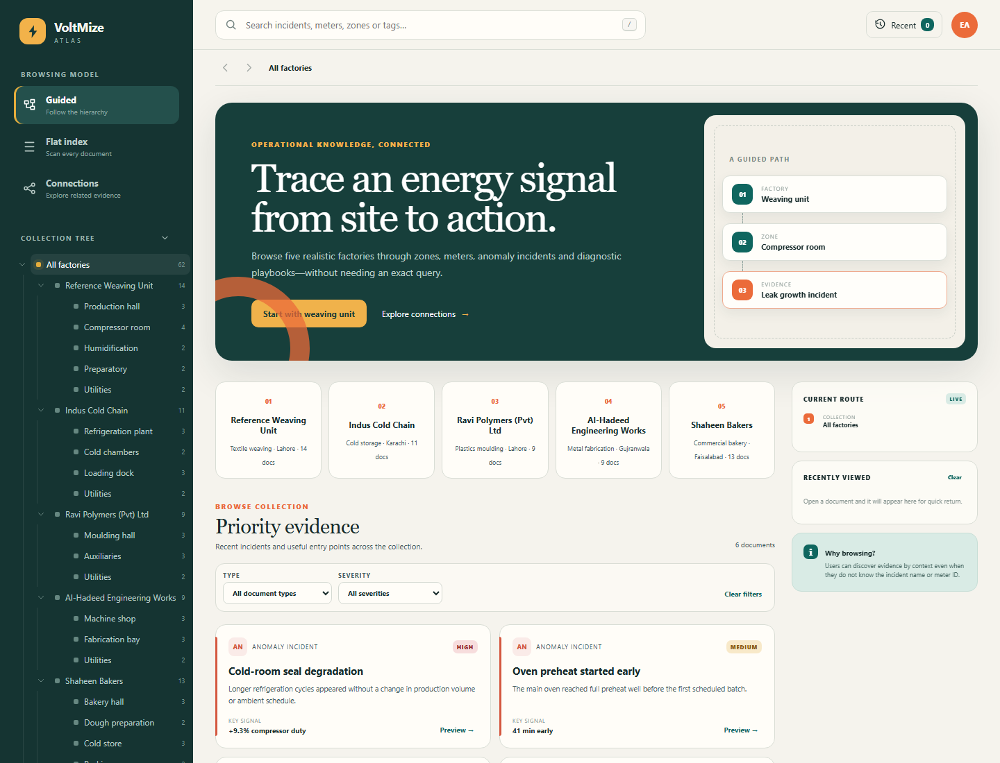

# VoltMize Week 5 — Browsing / Navigation Model

This folder contains a standalone implementation of the Week 5 IR assignment. It applies browsing models to VoltMize's domain without importing, starting, or modifying the FYP backend, frontend, database, or simulator.

## What was implemented

The site presents an **Energy Operations Knowledge Browser**. A user can move through:

```text
All factories → Factory → Zone → Meter / Incident / Playbook
```

This is appropriate for VoltMize because a user often notices a vague symptom—such as an expensive factory, an unusual zone, or a high overnight baseline—before knowing the exact meter ID or incident name. Browsing lets that user progressively discover the relevant evidence.

Three lecture models are available from the left menu:

- **Guided:** follows the factory and zone hierarchy.
- **Flat index:** scans all documents without a hierarchy.
- **Connections:** follows related-document links as a hypertext graph.

## Dataset

The primary dataset is a normalized SQLite database at `data/voltmize_browsing.db`; it is not a single hand-written JSON file.

- 5 factories
- 26 category nodes
- 62 documents
- 5 document types
- 166 directional document relationships
- full-text-search index (SQLite FTS5)

The records are synthetic teaching data based on the real FYP workflow and configuration concepts: factories, zones, meters, anomaly evidence, and diagnosis. They do not claim to be live production readings.

For easy inspection, the relational tables are also exported as CSV under `data/exports/`. The browser-ready `dist/assets/data.js` is generated from the same SQLite records so the page can run without a backend.

## Run the website

The quickest method is to open:

```text
Browzing/dist/index.html
```

For the most reliable browser behavior, serve it locally:

```powershell
cd F:\FYP\Browzing\dist
python -m http.server 8088
```

Then open `http://127.0.0.1:8088`.

No package installation, database server, Node server, or FYP service is required.

## Interface preview



The screenshot was captured from the generated site at a 1440 × 1100 desktop viewport. The layout is responsive for narrower screens as well.

## Regenerate and validate

From `F:\FYP`:

```powershell
python Browzing\scripts\generate_dataset.py
python Browzing\scripts\validate_dataset.py
node --check Browzing\dist\assets\app.js
```

## Folder structure

```text
Browzing/
├── data/
│   ├── schema.sql
│   ├── voltmize_browsing.db
│   └── exports/                 # CSV tables
├── dist/
│   ├── index.html               # open this page
│   └── assets/
│       ├── app.js
│       ├── data.js              # generated browser projection
│       ├── models/
│       │   ├── flat-model.js
│       │   ├── guided-model.js
│       │   └── hypertext-model.js
│       └── styles.css
├── lecture_reference/           # extracted Week 5 slide images
├── screenshots/
│   └── home.png                  # verified desktop render
├── scripts/
│   ├── generate_dataset.py
│   └── validate_dataset.py
├── ASSIGNMENT_MAPPING.md
├── MODEL_CODE_GUIDE.md
└── BROWSING_MODEL_EXPLANATION.md
```
